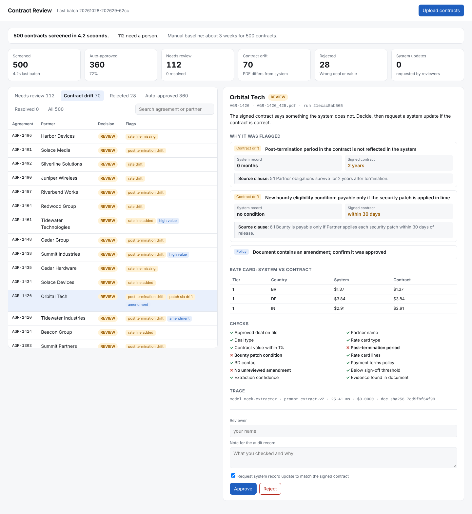
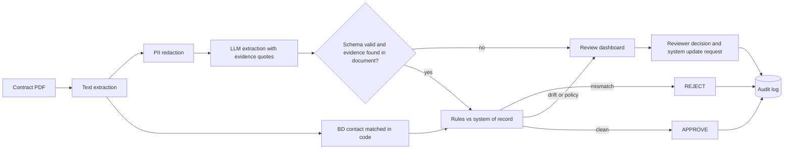
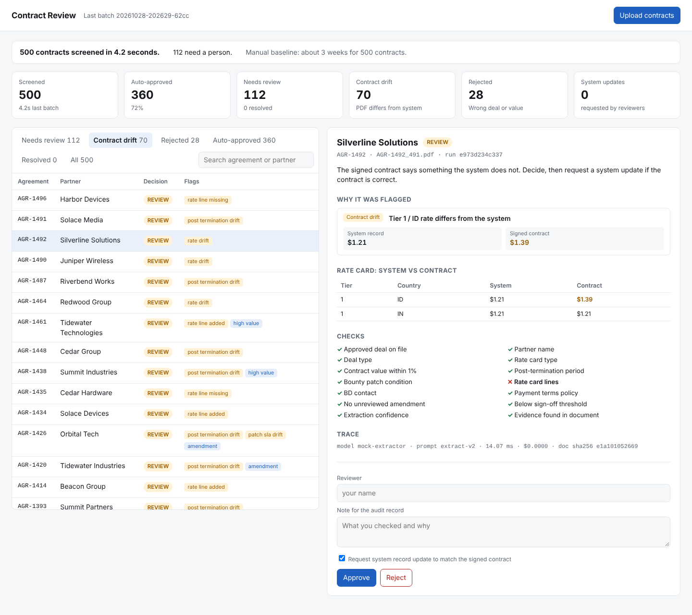
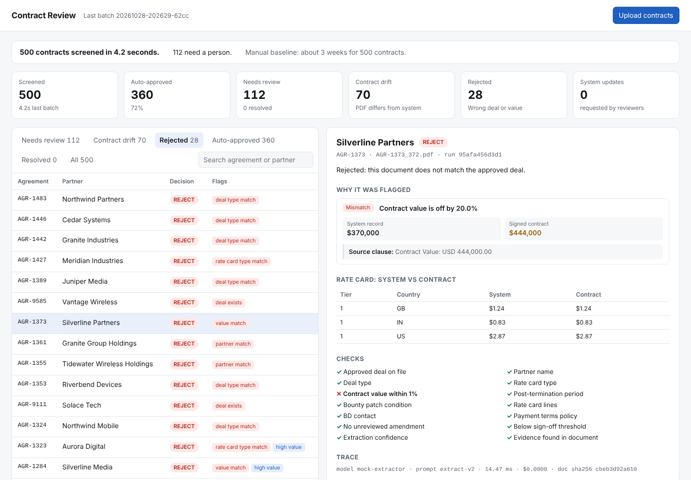
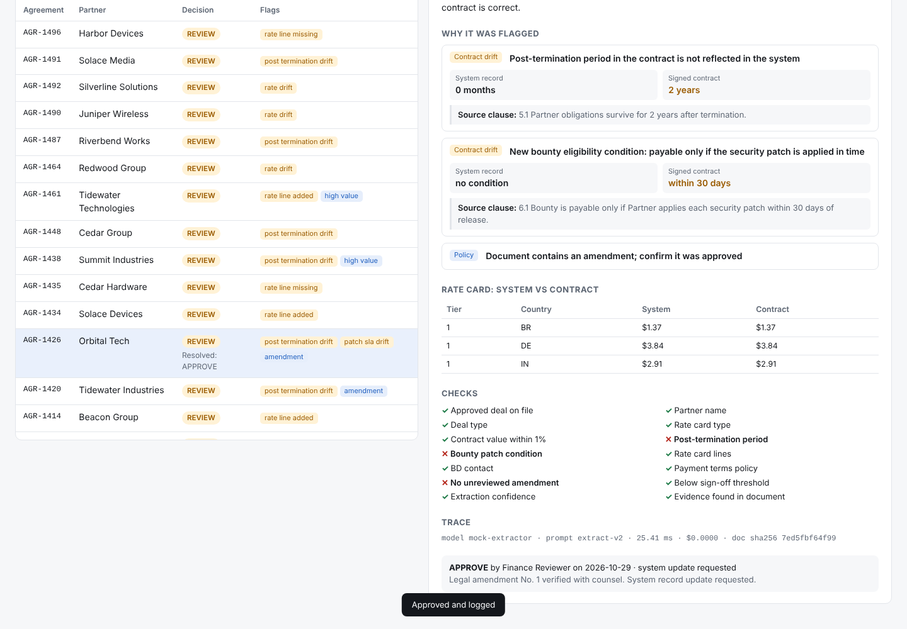
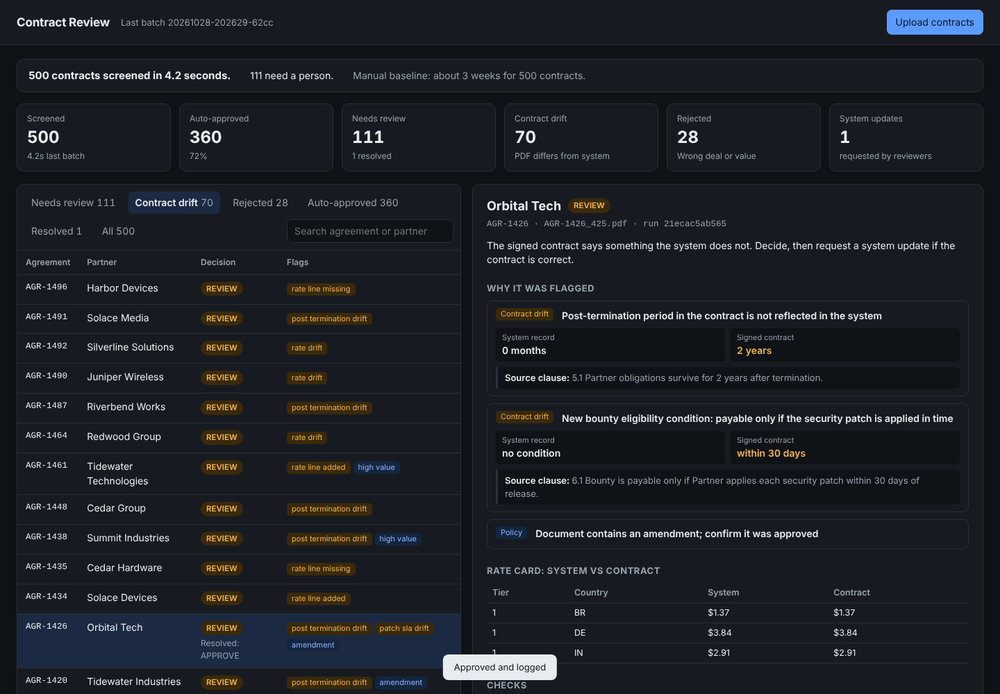

# Contract Drift Agent

**AI contract drift detection for Finance approvals**

An AI agent that screens partner contract PDFs for Finance approval. It auto-approves clean contracts, rejects mismatches, and sends contract drift and policy exceptions to a review dashboard, with every flag tied to the clause it came from.

**Source code is private. Live demo and code walkthrough available on request.**

## The problem

Finance teams approve thousands of partner contracts a quarter by reading each one against the approved deal. Manual review of 500 contracts takes about 3 weeks.

The costliest errors are not typos. They are **drift**: Legal amends a signed contract after the deal is approved, and the system of record never gets updated. For example, a deal is approved with no post-termination obligations. Legal later changes it to 2 years and makes the bounty payable only if the partner applies security patches within 30 days. That change lives only in the PDF. Payments run on the system, so they stay wrong until someone notices.

## Results on 500 synthetic contracts

| Measure | Result |
|---|---|
| Screening time | 500 PDFs in about 4 seconds |
| Auto-approved | 360 (72%) |
| Rejected | 28 |
| Sent to a reviewer | 112, of which 70 had contract drift |
| Match to labeled answers | 500 of 500 |
| False approvals | 0 |

These results use a deterministic extractor on template-generated PDFs, which proves the pipeline, rules, and gates end to end. Real-model accuracy on varied contracts is the next milestone. See [eval results](eval-results.md).

## What it does

- **Pipeline:** PII redaction, then LLM extraction, then schema validation, then deterministic rules against the deal table, then approve, reject, or escalate.
- **Contract drift detection:** compares post-termination period, bounty eligibility conditions, and every rate card line (device tier, country, rate) against the system of record, using the value in force after any amendment.
- **Evidence:** every flag shows the system value, the contract value, and the source clause. Quoted clauses are verified against the document, so a fabricated quote escalates instead of passing.
- **Human-in-the-loop:** escalations go to a review queue, and reviewers resolve them with a note and can request a system record update in one click.
- **Audit log:** stores a document hash (not the raw text) plus decision, rules fired, model, prompt version, tokens, cost, and latency.
- **Evals:** CI fails the build on any false approval or missed drift.
- **Gemini adapter:** ready for real model runs on Vertex AI.
- **Deployment and CI:** FastAPI service, Dockerfile, a Cloud Run deploy script with a least-privilege service account, and GitHub Actions.
- **Docs:** governance, decisions log, and a user guide for Finance reviewers.

## How it works

**The model extracts. Code decides.** The LLM never approves anything on its own, and it never sees personal data.

| Category | Checks | Result |
|---|---|---|
| Mismatch | No deal on file, partner, deal type, rate card type, value off by more than 1% | Reject |
| Drift | Post-termination period, bounty patch condition, rate changes, missing or added rate lines | Review |
| Policy | Non-standard payment terms, amendment present, high value, BD contact differs | Review |
| Quality | Schema failure, unreadable PDF, low confidence, evidence not found in document, cost over budget | Review |

## Release gates

Defined before building and enforced on every change:

| Gate | Target | Why |
|---|---|---|
| False approvals | 0 | Auto-approving a bad contract is the costliest failure |
| Drift recall | 100% | Every injected drift must be flagged |
| Decision accuracy | 90% or higher | Approve, reject, or review matches the labeled answer |

## Screens

**Rate card drift:** one line changed, highlighted against the system record.

**Rejected:** contract value does not match the approved deal.

**Resolved:** reviewer decision, note, and system update request recorded for audit.

**Dark mode**

## Design decisions

A few of the tradeoffs, with more in the [decisions log](decisions.md):

- **Drift escalates, it does not reject.** Post-approval Legal amendments are usually legitimate, so a reviewer decides and the system gets updated.
- **Amended value wins.** The original clause stays in the PDF, so a naive extractor reads it and misses the change.
- **Tests caught real bugs.** A PII pattern mislabeled account numbers as phone numbers, and the first 500-contract parallel batch exposed a database concurrency issue that single-threaded tests missed.

## Docs

- [Governance](governance.md): data classification, PII handling, audit trail, access
- [Decisions](decisions.md): tradeoffs, bugs caught, what's next
- [User guide](user-guide.md): for Finance reviewers
- [Eval results](eval-results.md)

## Stack

Python, FastAPI, Pydantic, Gemini on Vertex AI, pypdf, SQLite (BigQuery-ready schema), Docker, Cloud Run, GitHub Actions.

All data is synthetic. No real partners, people, or contract terms are used.

